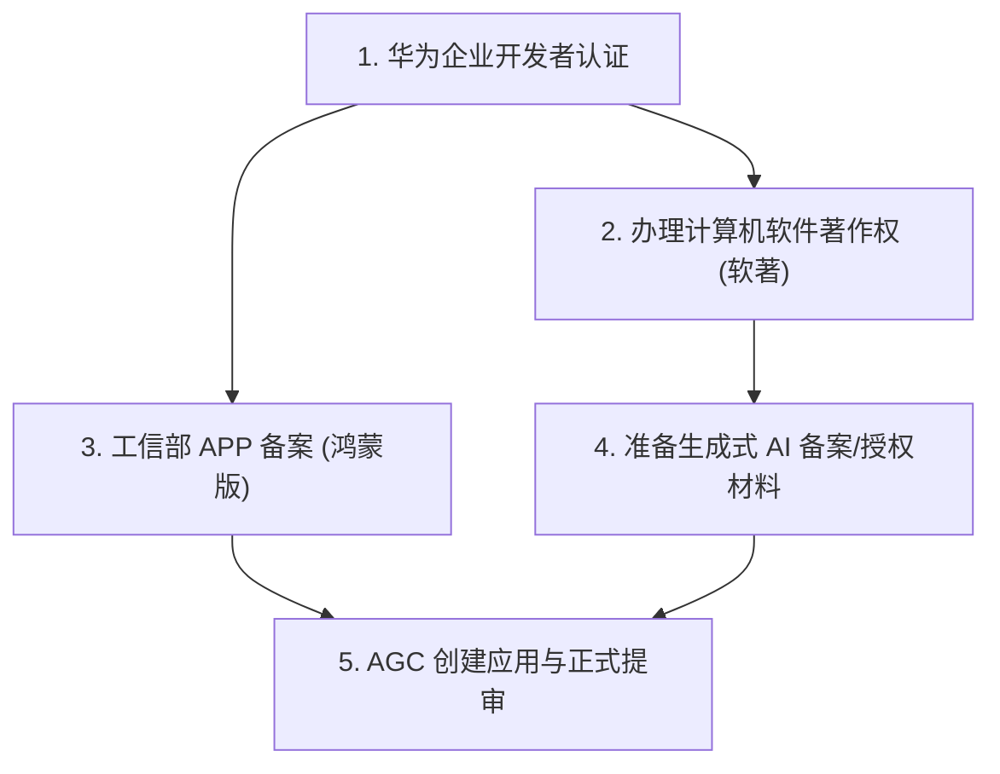

# 华为鸿蒙应用（光语助手 LuminaAssist）上市与上架实操指南

> 本指南针对华为应用市场（AppGallery Connect, AGC）最新的 **HarmonyOS NEXT 审核规范**、**工信部 APP 备案规定**及**《生成式人工智能服务管理暂行办法》**编制。

---

## 一、 AI 已为您在代码与工程端完成的改造

为避免被华为审核团队“一票否决”，代码端已完成以下 6 项核心合规改造：

### 1. 消除冷启动“一揽子”权限索取
* **修改文件**：[`LuminaApp/entry/src/main/ets/entryability/EntryAbility.ets`](LuminaApp/entry/src/main/ets/entryability/EntryAbility.ets)
* **改造内容**：彻底移除了 `onCreate` 阶段对麦克风、相机、通讯录等敏感权限的批量弹窗索取，启动时仅做静默环境准备，杜绝违规。

### 2. 敏感权限全面改造为“按需动态申请”
* **修改文件**：[`LuminaApp/entry/src/main/ets/pages/Index.ets`](LuminaApp/entry/src/main/ets/pages/Index.ets) & [`VisionService.ets`](LuminaApp/entry/src/main/ets/services/VisionService.ets)
* **改造内容**：
  * **麦克风权限**：用户按下屏幕发起语音输入时，才动态探测并申请 `ohos.permission.MICROPHONE`；
  * **相机权限**：用户触发拍照识药、识物或文档朗读时，才动态探测并申请 `ohos.permission.CAMERA`；
  * 拒绝授权时提供友好的 TTS 语音说明与错误提示，不崩溃、不强退。

### 3. 清理废弃高危权限，收敛权限使用场景
* **修改文件**：[`LuminaApp/entry/src/main/module.json5`](LuminaApp/entry/src/main/module.json5)
* **改造内容**：
  * 移除了 HarmonyOS NEXT 中已废弃且属于高危受限的 `ohos.permission.READ_MEDIA`；
  * 将麦克风、相机、通讯录的 `usedScene.when` 从违规的 `"always"` 改为合规的 `"inuse"`（仅在前台使用时生效）。

### 4. 增加首次启动《用户协议与隐私保护政策》合规弹窗
* **新增组件**：[`LuminaApp/entry/src/main/ets/components/PrivacyDialog.ets`](LuminaApp/entry/src/main/ets/components/PrivacyDialog.ets)
* **改造内容**：
  * 应用首次安装打开时，以居中模态弹窗清晰呈现隐私指引、权限按需说明、数据脱敏机制及 AI 健康免责提示；
  * 在用户明确点击“同意并继续使用”前，不初始化网络传输、不播放迎宾 TTS；若点击“不同意”，应用安全退出。

### 5. 设置页合规能力补齐（备案号、免责声明、隐私撤回）
* **修改文件**：[`LuminaApp/entry/src/main/ets/pages/SettingsPage.ets`](LuminaApp/entry/src/main/ets/pages/SettingsPage.ets)
* **改造内容**：
  * **协议查看**：底部的“免责声明”、“隐私政策”、“AI合规与举报”改为真实可点击弹窗，展示完整条款与不良信息举报邮箱（`feedback@lumina.assist`）；
  * **工信部备案号**：底部显著位置展示工信部 APP 备案号，支持语音朗读；
  * **撤回授权**：增加了“撤回隐私政策授权并退出”按钮，赋予用户随时撤销隐私同意并重置本地状态的权利（华为审核硬性检查项）。

### 6. 云端上线公开 HTTPS 隐私政策与服务协议网页
* **修改文件**：[`backend/main.py`](backend/main.py)
* **改造内容**：
  * 后端新增 `/privacy` 和 `/terms` 路由，渲染独立排版的公开 HTML 网页；
  * 当前公网访问地址（可直接填入 AGC 提审后台）：
    * 隐私政策：`https://invision-lewis-theatre-bids.trycloudflare.com/privacy`
    * 用户协议：`https://invision-lewis-theatre-bids.trycloudflare.com/terms`

---

## 二、 需要您（开发者/负责人）线下办理与操作的事项

以下事项涉及法律主体认证、政务备案及华为开发者联盟后台操作，需要您亲自推进：

### 阶段一：资质准入与政务备案（耗时较长，建议立即启动）



1. **华为开发者账号实名认证（优先企业认证）**
   * **操作**：登录 [华为开发者联盟官网](https://developer.huawei.com/) 完成实名认证；
   * **建议**：强烈建议认证为**企业开发者**（营业执照 + 法人核验）。个人开发者无法上架具备受限权限、内购支付或复杂业务的 AI 应用。

2. **办理计算机软件著作权证书（软著 / 电子版权 DCI）**
   * **材料要求**：软件全称必须包含“光语助手”，著作权人必须与华为开发者账号主体完全一致；
   * **途径**：中国版权保护中心（加急或普通）或第三方版权服务机构，取得电子版权认证证书（带二维码与核验码）。

3. **工信部 APP 备案（全国强制）**
   * **办理入口**：在您的服务器接入商（如华为云控制台 -> ICP 备案系统）办理；
   * **APP 特征信息填报**：
     * 应用名称：光语助手
     * 运行平台：勾选 **HarmonyOS**
     * 包名（Bundle Name）：`lumi.na.app`
     * 证书指纹：从正式发布证书提取 SHA-256 指纹值；
   * **办结结果**：获得类似 `粤ICP备XXXXXXXX号-1A` 的备案号，届时将其同步到 `AppConfig.ets`。

4. **生成式 AI / 大模型合规备案登记**
   * 光语助手包含视觉大模型与文字生成：
   * **合规方案（三轨制）**：如果您使用的是第三方已通过网信办备案的大模型（如阿里云通义千问、智谱清言 GLM），准备该基座模型的官方备案公告名称/备案号，并在华为审核备注中填写《大模型服务使用说明》。

---

### 阶段二：生成正式 Release 签名与打包（在 DevEco Studio 中操作）

> 上架华为应用市场必须使用 AGC 签发的正式 **Release 证书**，不能使用 Debug 证书！

1. **生成正式密钥与 CSR 申请文件**：
   * 在 DevEco Studio 中，打开菜单栏：`Build` -> `Generate Key and CSR`；
   * Key Store Path 选择保存路径（建议保存在安全目录，如 `LuminaApp/keys/release.p12`），设置密码与 Alias（如 `releaseKey`）；
   * 填写证书信息（国家 CN、组织、应用名称等），生成 `release.csr`。

2. **在 AGC 后台申请发布证书与 Profile**：
   * 登录 [AppGallery Connect](https://developer.huawei.com/consumer/cn/service/josp/agc/index.html) -> **我的项目** -> **用户与访问** -> **证书管理**；
   * 点击“新增证书”，类型选择**“发布证书”**，上传刚才生成的 `release.csr`，下载签发好的 `release.cer`；
   * 进入 **“Profile 管理”**，点击“添加 Profile”：
     * 类型选择：**发布**；
     * 选择包名：`lumi.na.app`；
     * 绑定刚才下载的发布证书；
     * 下载生成的 `release.p7b`。

3. **在 DevEco Studio 中导入正式签名并打包**：
   * 打开 `File` -> `Project Structure` -> `Project` -> `Signing Configs`；
   * 切换到 `release` 配置，导入 `release.p12`、`release.cer`、`release.p7b` 及对应密码；
   * 点击顶部菜单：`Build` -> `Build Hap(s)/APP(s)` -> **`Build APP(s)`**；
   * 构建成功后，在 `entry/build/default/outputs/default/` 目录下获取正式的 **`.app`** 发布包。

---

### 阶段三：AppGallery Connect 后台物料准备与提交审核

登录 AGC 控制台，进入“我的应用” -> 选择或新建应用，填报以下内容：

1. **基本物料准备**：
   * **应用图标（Icon）**：216×216 或 512×512 PNG，正方形直角无透明通道；
   * **真实运行截图**：至少 3 张竖屏高清截图（建议 1080×2400 或以上），必须是 HarmonyOS 真机或模拟器实际运行画面，绝不能包含 Android/iOS 状态栏痕迹；
   * **应用分类**：推荐选择 `实用工具` 或 `生活服务` -> `无障碍关怀`。

2. **合规信息录入**：
   * **隐私政策网址**：填入 `https://invision-lewis-theatre-bids.trycloudflare.com/privacy`（后续若绑定自有域名，同步更新即可）；
   * **ICP 备案号**：填报工信部核发的正式备案号；
   * **版权资质**：上传计算机软件著作权登记证书扫描件（PDF 或 JPG）。

3. **审核备注（非常重要，建议直接复制以下模板）**：
   ```text
   【应用说明与测试指引】
   1. 产品定位：光语助手专为视障人士及银发长者打造，提供全语音交互、药品包装识别、物品定位及文档朗读等无障碍生活关怀服务。
   2. 权限使用说明：
      - 麦克风权限：仅在用户主动按住语音按钮或发起语音指令时按需申请，识别完成后即时关闭；
      - 相机权限：仅在用户主动发起药品/物品拍照识图时按需申请，单帧处理完毕即时销毁，不存储人脸或生物特征；
      - 本应用已在首次启动时弹窗征得用户隐私同意，并提供撤回授权与本地数据脱敏能力。
   3. 测试账号：本应用核心功能无需强制注册登录，打开即可全量体验。
   4. 演示视频链接：[可在此附上演示视频的网盘链接供审核员快速了解]
   ```

---

## 三、 进度对照 CheckList

- [x] 代码端：移除启动批量权限申请（已完成）
- [x] 代码端：麦克风与相机按需动态申请（已完成）
- [x] 代码端：首次启动用户协议与隐私弹窗（已完成）
- [x] 代码端：设置页合规条款弹窗、备案号与撤销授权（已完成）
- [x] 服务端：公网可访问的 HTTPS 隐私政策与服务协议网页（已完成）
- [ ] 线下：华为开发者账号企业认证
- [ ] 线下：办理软件著作权证书（软著）
- [ ] 线下：工信部 APP 备案（鸿蒙平台）
- [ ] 线下：DevEco Studio 生成 release.p12 与 release.csr
- [ ] AGC平台：申请 release.cer 与 release.p7b 并打包 `.app`
- [ ] AGC平台：上传截屏、图标、资质并提交审核
